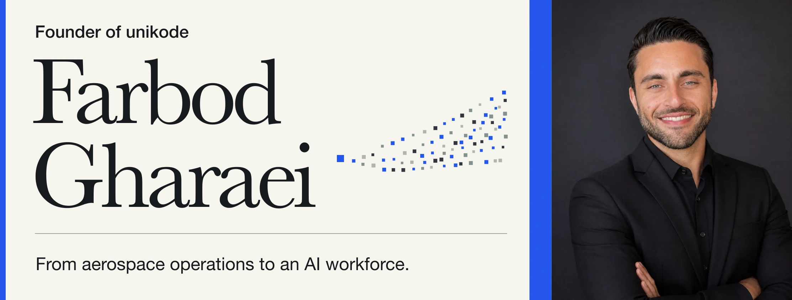
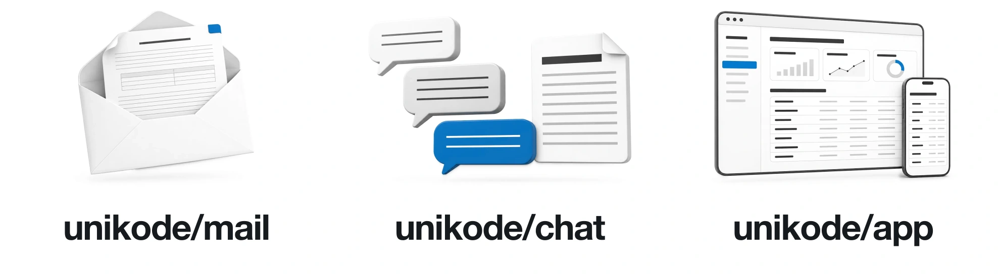
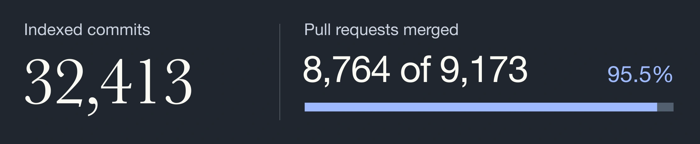
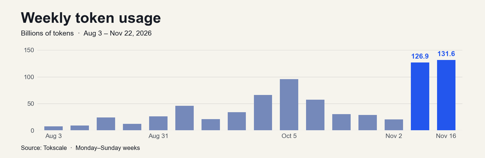

<picture>
  <source media="(max-width: 640px)" srcset="assets/cover-mobile.webp">
  
</picture>

[Explore the platform](https://www.unikode.ai/platform/) · [32,413 commits](#github-activity) · [949.05B tokens](#token-usage) · [Contact](https://www.unikode.ai/contact/)

## Building unikode

I spent more than a decade working on enterprise systems in aerospace and industry. Today I’m building **unikode**, a platform where you give a team of AI agents an assignment and review what they bring back.

Take a letter an attorney needs to draft from a matter file. The attorney supplies the documents and a template. The team returns a draft, points back to the sources, and flags facts the file leaves open. The attorney can ask for revisions and decides what gets sent. [Read the legal workflow](https://www.unikode.ai/blog/legal-work-is-an-execution-system/)

A brief can start in an email, a conversation in ChatGPT or Claude, or a dedicated app. I’m interested in how that changes the tools we use every day. [The future of work interfaces](https://www.unikode.ai/blog/future-work-interfaces/)

## GitHub activity

<picture>
  <source media="(max-width: 640px)" srcset="assets/github-activity-mobile.webp">
  
</picture>

I’ve also reviewed **312 distinct pull requests** and opened **9,420 issues**.

November 27, 2026 snapshot across public and private work. GitHub indexes these commits on default branches.

## Token usage

**949.05 billion tokens** across Claude Code, Codex, GitHub Copilot, and Gemini CLI on my workstation. The two busiest weeks in the 16-week chart came back to back in November, with **126.9 billion** and **131.6 billion** tokens. [Public usage history on Tokscale](https://tokscale.ai/u/unikode-00)

<picture>
  <source media="(max-width: 640px)" srcset="assets/weekly-usage-mobile.png">
  
</picture>

<b>Exact totals by tool and leaderboard</b>

Lifetime workstation usage reported by Tokscale on November 27, 2026.

| Tool | Tokens |
| --- | ---: |
| Claude Code | 812,152,732,815 |
| Codex | 136,694,478,692 |
| GitHub Copilot | 131,901,475 |
| Gemini CLI | 72,651,767 |
| **Total** | **949,051,764,749** |

Each leaderboard measures overlapping activity. CCgather covers Claude Code only.

| Public profile | Tokens on November 27, 2026 |
| --- | ---: |
| [Tokscale](https://tokscale.ai/u/unikode-00) | 949,051,764,749 |
| [Tokens.ci](https://tokens.ci/u/unikode-00) | 949,036,886,063 |
| [VibeRank](https://www.viberank.app/profile/unikode-00) | 949,078,660,122 |
| [CCgather](https://ccgather.com/leaderboard?u=unikode-00&period=all) | 812,266,347,309 |

