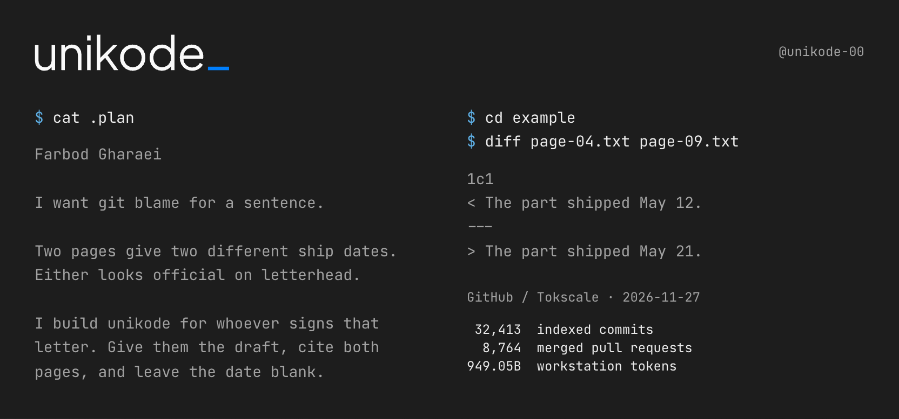

<picture>
  <source media="(max-width: 600px), (min-width: 768px) and (max-width: 960px)" srcset="assets/shell-mobile.png">
  
</picture>

[Read the plain-text .plan](https://github.com/unikode-00/unikode-00/blob/main/.plan) · [Try the two-file diff](https://github.com/unikode-00/unikode-00/tree/main/example)

In unikode, the AI agent drafting the letter and the agent checking it work from the same matter file. The lawyer can follow a citation back to the page, challenge the reading, and send the draft through another pass. A brief can start in `unikode/mail`, `unikode/chat`, or `unikode/app`. [Follow a legal assignment](https://www.unikode.ai/blog/legal-work-is-an-execution-system/) · [Explore the interfaces](https://www.unikode.ai/products/)

GitHub counts and scope

| Activity | Count |
| --- | ---: |
| Commits indexed on default branches | 32,413 |
| Pull requests opened | 9,173 |
| Of those, pull requests merged | 8,764 |
| Distinct pull requests reviewed | 312 |
| Issues opened | 9,420 |

Account totals across public and private work as of November 27, 2026.

## What the counters say

Tokscale counted **949,051,764,749 workstation tokens** through November 27, 2026. The two busiest weeks in this 16-week window landed back to back, at **126.9 billion** and **131.6 billion**.

<picture>
  <source media="(max-width: 600px), (min-width: 768px) and (max-width: 960px)" srcset="assets/usage-mobile.png">
  
</picture>

[Tokscale](https://tokscale.ai/u/unikode-00) · [Tokens.ci](https://tokens.ci/u/unikode-00) · [VibeRank](https://www.viberank.app/profile/unikode-00) · [CCgather](https://ccgather.com/leaderboard?u=unikode-00&period=all)

Exact token counts by tool and leaderboard

Lifetime workstation usage reported by Tokscale on November 27, 2026.

| Tool | Tokens |
| --- | ---: |
| Claude Code | 812,152,732,815 |
| Codex | 136,694,478,692 |
| GitHub Copilot | 131,901,475 |
| Gemini CLI | 72,651,767 |
| **Total** | **949,051,764,749** |

The public trackers cover overlapping usage. CCgather counts Claude Code only.

| Tracker | Tokens on November 27, 2026 |
| --- | ---: |
| Tokscale | 949,051,764,749 |
| Tokens.ci | 949,036,886,063 |
| VibeRank | 949,078,660,122 |
| CCgather | 812,266,347,309 |

