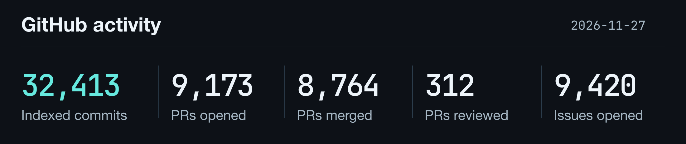
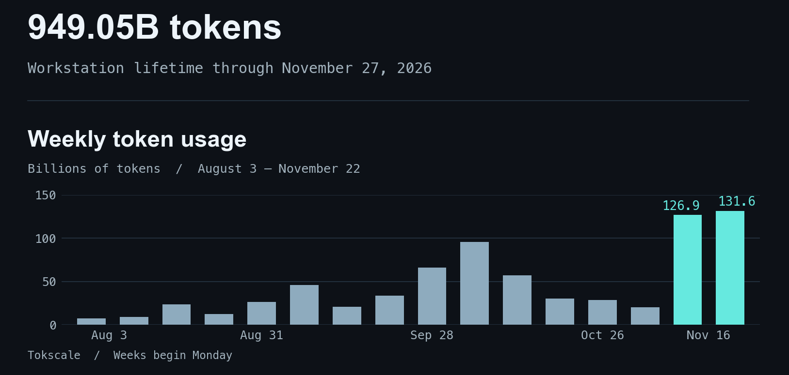

<picture>
  <source media="(max-width: 900px)" srcset="assets/platform-mobile.webp">
  
</picture>

**unikode** routes a request to specialist agents, checks their output against the brief, and returns the work for human review. Requests come in through `unikode/mail`, `unikode/chat`, or `unikode/app`.

[Platform](https://www.unikode.ai/platform/) · [Interfaces](https://www.unikode.ai/products/) · [Example workflow](https://www.unikode.ai/blog/legal-work-is-an-execution-system/)

<picture>
  <source media="(max-width: 900px)" srcset="assets/activity-mobile.webp">
  
</picture>

GitHub counts and scope

| Activity | Count |
| --- | ---: |
| Commits indexed on default branches | 32,413 |
| Pull requests opened | 9,173 |
| Of those, pull requests merged | 8,764 |
| Distinct pull requests reviewed | 312 |
| Issues opened | 9,420 |

Account totals across public and private work as of November 27, 2026.

<picture>
  <source media="(max-width: 900px)" srcset="assets/weekly-mobile.png">
  
</picture>

[Tokscale](https://tokscale.ai/u/unikode-00) · [Tokens.ci](https://tokens.ci/u/unikode-00) · [VibeRank](https://www.viberank.app/profile/unikode-00) · [CCgather](https://ccgather.com/leaderboard?u=unikode-00&period=all)

Exact token counts by tool and leaderboard

Lifetime workstation usage reported by Tokscale on November 27, 2026.

| Tool | Tokens |
| --- | ---: |
| Claude Code | 812,152,732,815 |
| Codex | 136,694,478,692 |
| GitHub Copilot | 131,901,475 |
| Gemini CLI | 72,651,767 |
| **Total** | **949,051,764,749** |

The public trackers cover overlapping usage. CCgather counts Claude Code only.

| Tracker | Tokens on November 27, 2026 |
| --- | ---: |
| Tokscale | 949,051,764,749 |
| Tokens.ci | 949,036,886,063 |
| VibeRank | 949,078,660,122 |
| CCgather | 812,266,347,309 |

