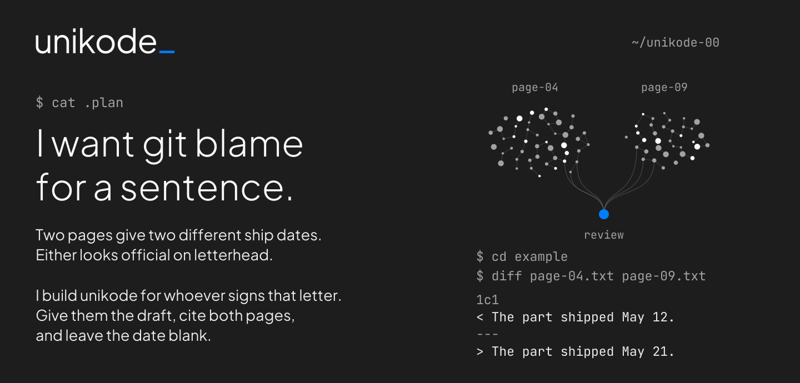
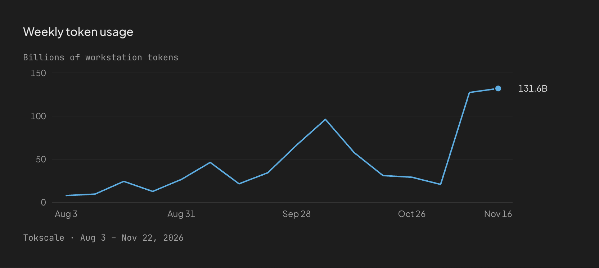

<picture>
  <source media="(max-width: 1100px)" srcset="assets/shell-mobile-v2.svg">
  
</picture>

[Read the .plan](.plan) · [Run the two-file example](example/) · [unikode.ai](https://www.unikode.ai/)

## A draft should keep its sources.

In unikode, the AI agent drafting a letter and the agent checking it work from the same matter file. The lawyer can follow a citation back to the page, challenge the reading, and send the draft through another pass.

**The platform for the AI workforce.** Start with a brief in [mail](https://www.unikode.ai/products/#mail), [chat](https://www.unikode.ai/products/#chat), or [app](https://www.unikode.ai/products/#app).

[Follow a legal assignment →](https://www.unikode.ai/blog/legal-work-is-an-execution-system/)

<details>
<summary>Read the shell as text</summary>

```text
$ cat .plan
Farbod Gharaei

I want git blame for a sentence.

Two pages give two different ship dates.
Either looks official on letterhead.

I build unikode for whoever signs that letter. Give them the draft,
cite both pages, and leave the date blank.
```

The two source files in [example/](example/) are fictional. The command and its output are real:

```text
$ diff example/page-04.txt example/page-09.txt
1c1
< The part shipped May 12.
---
> The part shipped May 21.
```

</details>

## Engineering activity

| GitHub activity | November 27, 2026 |
| :--- | ---: |
| Commits indexed on default branches | **32,413** |
| Pull requests merged | **8,764** |

<details>
<summary>Full GitHub counts and scope</summary>

| Activity | Count |
| :--- | ---: |
| Commits indexed on default branches | 32,413 |
| Pull requests opened | 9,173 |
| Of those, pull requests merged | 8,764 |
| Distinct pull requests reviewed | 312 |
| Issues opened | 9,420 |

Account totals across public and private work, recorded on November 27, 2026. These are a dated snapshot.

</details>

## Workstation usage

**949.05 billion tokens** reported by [Tokscale](https://tokscale.ai/u/unikode-00) through November 27, 2026. The exact recorded total is **949,051,764,749**.

<picture>
  <source media="(max-width: 600px), (min-width: 768px) and (max-width: 960px)" srcset="assets/usage-mobile.png">
  
</picture>

[Tokscale](https://tokscale.ai/u/unikode-00) · [Tokens.ci](https://tokens.ci/u/unikode-00) · [VibeRank](https://www.viberank.app/profile/unikode-00) · [CCgather](https://ccgather.com/leaderboard?u=unikode-00&period=all)

<details>
<summary>Exact counts, tools, and measurement scope</summary>

Lifetime workstation usage reported by Tokscale on November 27, 2026.

| Tool | Tokens |
| :--- | ---: |
| Claude Code | 812,152,732,815 |
| Codex | 136,694,478,692 |
| GitHub Copilot | 131,901,475 |
| Gemini CLI | 72,651,767 |
| **Total** | **949,051,764,749** |

The public trackers cover overlapping usage and must not be added together. CCgather counts Claude Code only. Token volume measures usage; delivered value and output quality require separate evidence.

| Tracker | Tokens on November 27, 2026 |
| :--- | ---: |
| Tokscale | 949,051,764,749 |
| Tokens.ci | 949,036,886,063 |
| VibeRank | 949,078,660,122 |
| CCgather | 812,266,347,309 |

</details>
